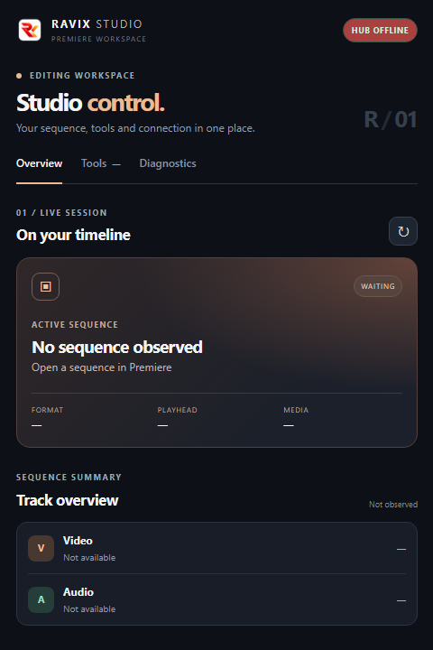

<p align="center">
  
</p>

# RAVIX Studio

> **Author**: Ranjan Vishwakarma ([@ranjanvish](https://github.com/ranjanvish))  
> **Repository**: [https://github.com/ranjanvish/RAVIX-Studio](https://github.com/ranjanvish/RAVIX-Studio)  
> **Version**: `10.0.101`  
> **Extension Bundle ID**: `com.ravix.studio`  
> **Host Target**: Adobe Premiere Pro (v14.0 - 99.9+)

---

## 🖼️ User Interface

<p align="center">
  
</p>

---

## Overview

**RAVIX Studio** is an advanced CEP (Common Extensibility Platform) panel extension for Adobe Premiere Pro. It forms the timeline execution and automation layer of the **RAVIX** ecosystem, enabling real-time bi-directional synchronization between Premiere Pro, the local **RAVIX Hub** (`http://127.0.0.1:17841`), and coding agents.

### Key Capabilities
- **Timeline Telepathy**: Live-inspects active sequence, format, playhead position, marker points, and video/audio tracks.
- **Automated Media Import & Placement**: Seamlessly places generated footage, WhisperX-aligned audio beats, and layered sound effects directly onto sequence tracks.
- **Marker & Callout Dispatch**: Injects synchronized cues, labels, and chapter markers into Premiere timelines automatically.
- **Non-Destructive Active Timeline Edits**: Executes surgical timeline operations directly on the user's active sequence without creating duplicate project clones.

---

## Installation

1. Copy or symlink this folder to your Adobe CEP extensions folder:
   ```powershell
   # Windows CEP directory:
   %APPDATA%\Adobe\CEP\extensions\RAVIXStudio
   ```
2. Enable Adobe CEP PlayerDebugMode in Windows Registry:
   ```reg
   reg add "HKEY_CURRENT_USER\Software\Adobe\CSXS.11" /v PlayerDebugMode /t REG_SZ /d 1 /f
   ```
3. Launch Adobe Premiere Pro.
4. Go to **Window > Extensions > RAVIX Studio**.

---

## License

Copyright © 2026 Ranjan Vishwakarma. All rights reserved.  
Licensed for personal and automated production workflows.
